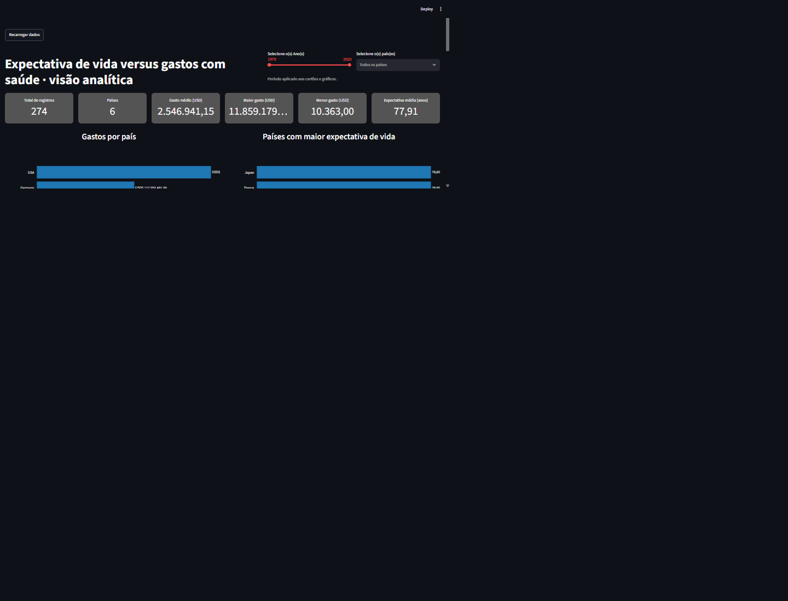

# Expectativa de vida versus gastos com saúde

Projeto de engenharia e análise de dados que transforma dados públicos de gastos
com saúde e expectativa de vida em um dashboard interativo.

O projeto utiliza o dataset [Health Expenditure and Life Expectancy](https://www.timestored.com/data/sample/healthexp.csv), com registros por país e ano.

## Dashboard



O dashboard, desenvolvido com Streamlit, apresenta:

- seis indicadores de registros, países, gastos e expectativa de vida;
- gráficos de gastos por país, expectativa de vida e evolução ao longo do tempo;
- tabelas de ranking e conferência;
- filtros de ano e país, além de seleções nos gráficos que atualizam os demais
  visuais e indicadores.

## Tecnologias

- Python 3.12.10 ou superior
- [uv](https://docs.astral.sh/uv/)
- DuckDB
- pandas
- Streamlit
- Plotly

## Fluxo de dados

O pipeline organiza os dados em três camadas no banco
`expectativa_de_vida.duckdb`:

1. **raw** — carrega o CSV de origem sem transformar os valores.
2. **refined** — converte e normaliza os dados para os tipos usados pelo projeto.
3. **marts** — materializa dimensões e tabela fato para as consultas analíticas.

As consultas SQL usadas pelos indicadores e visuais ficam em `SQL/marts/`.
Os cálculos analíticos são realizados nessas consultas e reutilizados pelo
dashboard.

## Como executar

Instale as dependências do projeto:

```bash
uv sync
```

Execute as etapas do pipeline nesta ordem:

```bash
uv run python -m pipeline.ingestao
uv run python -m pipeline.transformacao
uv run python -m pipeline.marts
```

A ingestão usa `raw/healthexp.csv` quando o arquivo já existe. Caso contrário,
tenta baixá-lo da fonte indicada acima.

Inicie o dashboard:

```bash
uv run streamlit run app.py
```

O Streamlit exibirá no terminal o endereço local do dashboard.

## Estrutura do projeto

```text
.
├── app.py                 # Aplicação Streamlit
├── painel.py              # Leitura dos dados, formatação e gráficos
├── dashboard.png          # Captura do dashboard
├── pipeline/
│   ├── db.py              # Conexão e funções comuns do DuckDB
│   ├── ingestao.py        # Carregamento da camada raw
│   ├── transformacao.py   # Preparação da camada refined
│   └── marts.py           # Materialização da camada marts
├── raw/
│   └── healthexp.csv      # Arquivo de origem
├── SQL/
│   └── marts/             # Consultas analíticas
├── specs/
│   └── 4_Painel.md        # Especificação do dashboard
└── expectativa_de_vida.duckdb
```

## Fonte dos dados

- [Dataset Health Expenditure and Life Expectancy](https://www.timestored.com/data/sample/healthexp.csv)
- [Página de amostras do TimeStored](https://www.timestored.com/data/sample/)
